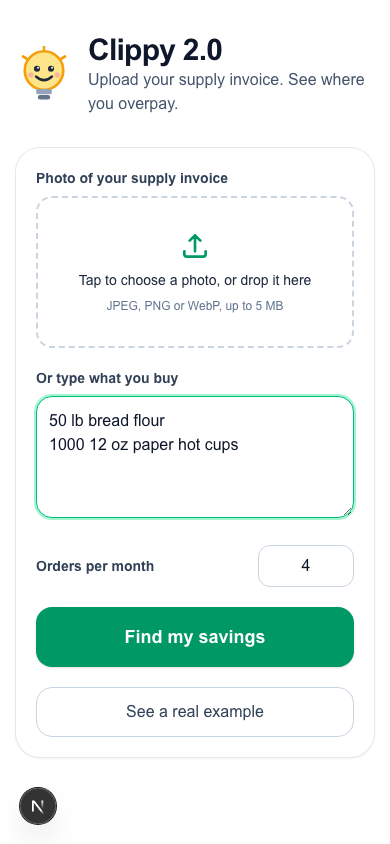
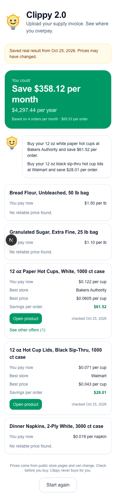
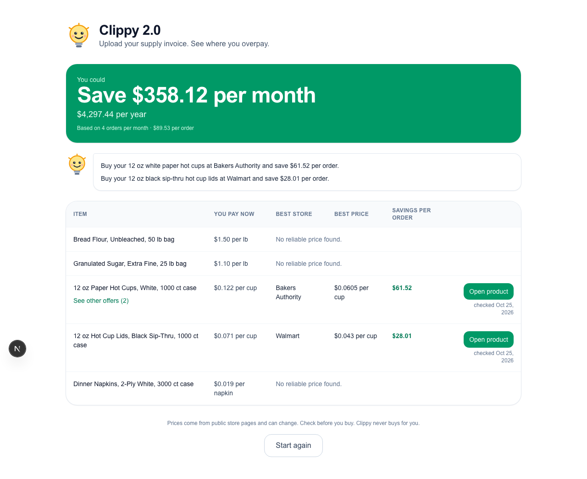

# Clippy 2.0

**Upload a photo of your supply invoice, and Clippy shows you which stores sell the same items for less, and how much you would save each month.**

Live demo: <LIVE_URL>

| Start | Your savings (phone) | Your savings (computer) |
| --- | --- | --- |
|  |  |  |

## How it works

1. **Add your items.** Take a photo of a supply invoice or receipt, or just type what you buy (for example "50 lb bread flour, 1000 12 oz cups").
2. **Clippy reads it.** It finds each item, the pack size, and the price you pay now.
3. **Clippy searches real stores.** It looks up the same items on public store websites.
4. **Clippy compares fairly.** It works out the real price per pound, per cup or per item, including shipping, so a big pack and a small pack can be compared.
5. **You see your savings.** For each item you see the cheapest store, a link to the product, the date the price was checked, and your savings per order, per month and per year.

Clippy never buys anything for you. You decide where to shop.

## Set up your own copy in 3 steps

You do not need to write code or set up a database.

1. **Deploy.** Click the button below and sign in to Vercel (free).

   

2. **Add your Anthropic key.** Make a key at [console.anthropic.com](https://console.anthropic.com) and paste it into Vercel as `ANTHROPIC_API_KEY`.
3. **Add your Tavily key.** Make a key at [tavily.com](https://tavily.com) and paste it into Vercel as `TAVILY_API_KEY`.

That's it. Open your new site and upload an invoice.

## What it costs

About **<COST_PER_ANALYSIS>** per invoice check (Anthropic and Tavily usage). There is no monthly fee from Clippy.

## Limits

- **Prices behind a login are not seen.** Clippy only reads public store pages, so it cannot see prices that need an account.
- **Member and contract prices are not included.** Warehouse club, wholesale and contract prices may be lower than what Clippy finds.
- **Prices change every day.** Each price shows the date it was checked. Always check the store page before you buy.
- **Clippy never buys.** It only shows you links. Nothing is ordered or paid for.
- If Clippy cannot find a reliable price for an item, it says "No reliable price found." It never guesses.

## What's next

- **Weekly invoice forwarding:** email your invoice to Clippy and get a savings report every week.
- **Price alerts:** get a message when an item you buy gets cheaper.
- **Local stock:** see which stores near you have the item today.

## Built with

[Claude](https://www.anthropic.com/claude) by Anthropic reads invoices and store pages. [Tavily](https://tavily.com) searches the web for store prices.

## License

[MIT](LICENSE)
